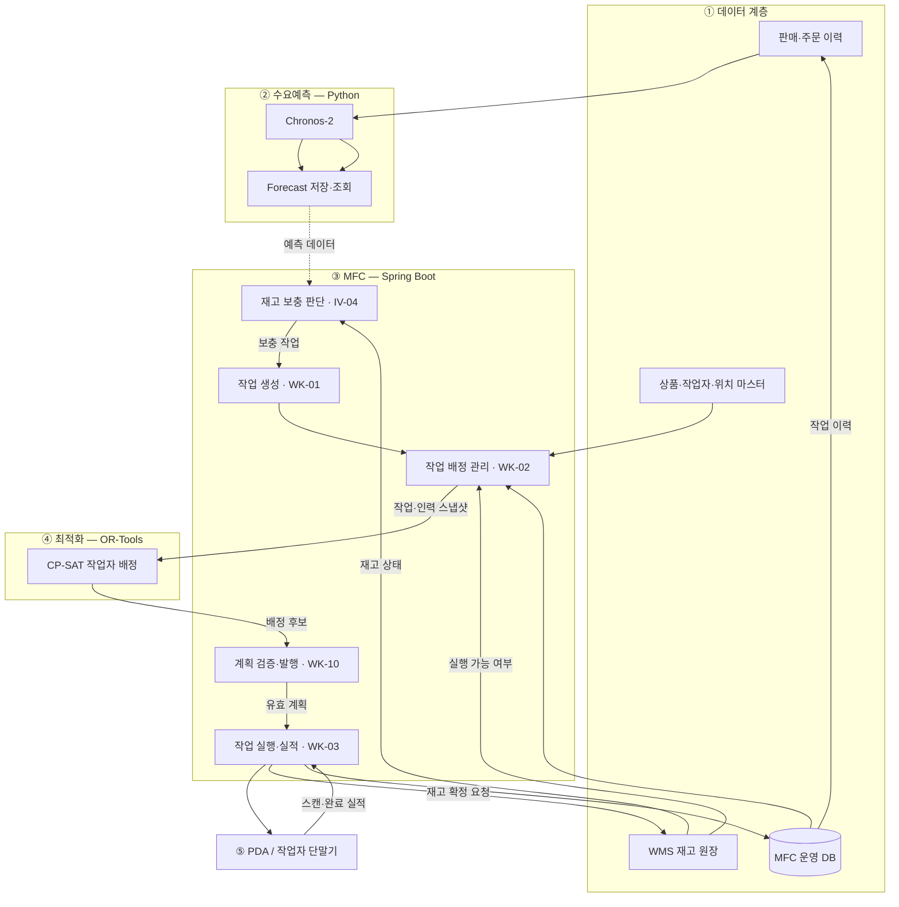
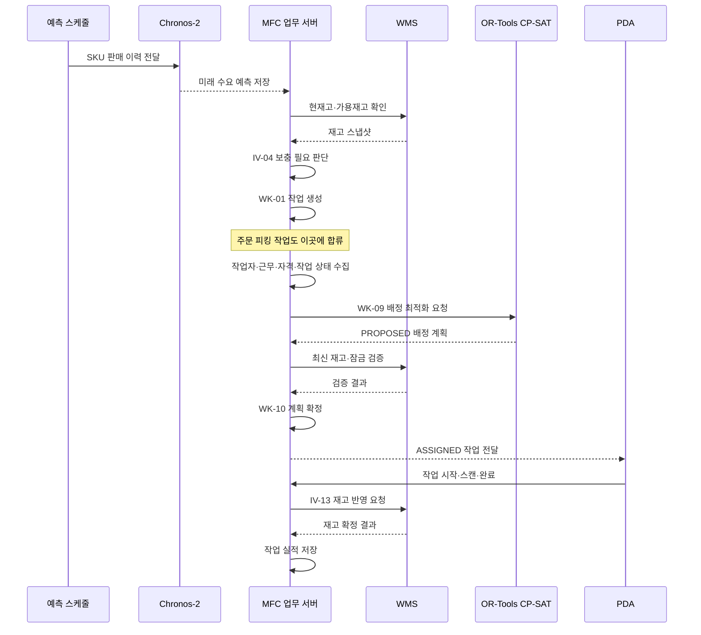

# MFC 시스템 구성안 — Chronos-2 + Google OR-Tools

확정하신 두 기술을 기준으로, 첨부하신 MFC 로직을 유지하면서 실제 구현에 필요한 시스템 조합을 구성하겠습니다.

**확정된 기술**

Chronos-2

SKU별 수요 예측

미래 판매량·수요 구간 산출

Google OR-Tools

작업자 배정 최적화

작업·인력·시간표 계산

이 두 가지가 확정되었다고 가정하면, MFC에는 **수요예측 시스템, 작업관리 시스템, 최적화 시스템, 재고관리 연동, 작업실행 시스템**이 필요합니다.

## 1\. 전체 시스템 아키텍처

첨부 문서의 WK-01·02·03·09·10, IV-04 및 WMS 재고 정본 경계를 기반으로 구성한 제안입니다. Python 분리, 예측 결과 저장소, 통신 방식은 신규 설계 사항입니다.

여기서 중요한 점은 **Chronos-2와 OR-Tools를 반드시 직접 연결할 필요는 없다는 것**입니다.

Chronos-2는 예상 수요를 MFC 업무 로직에 제공하고, MFC가 실제 작업을 생성한 다음 OR-Tools가 그 작업을 수행할 작업자를 계산하도록 구성하는 것이 적절합니다.

## 2\. 필요한 기술 조합

| 구성요소 | 기술 조합 | 담당 역할 | 구분 |
|--------|--------|--------|--------|
| MFC 업무 서버 | Java + Spring Boot | 작업 생성·상태·배정·실행 | 기존 스택 활용 |
| 수요예측 서비스 | Python + PyTorch + Chronos-2 | SKU별 판매량 예측 | 확정 모델 |
| 작업 배정 엔진 | Google OR-Tools CP-SAT | 작업자·작업시간 최적화 | 확정 도구 |
| AI 연동 | Spring WebClient + REST API | MFC ↔ Python 서비스 요청·응답 | 제안 |
| 데이터 저장 | PostgreSQL | MFC 작업·배정·예측 결과 저장 | 제안 |
| 재고 정본 | WMS 재고 모듈/API | 실제 수량·LOT·예약·위치 확정 | 문서상 책임 |
| 이벤트 전달 | Kafka | 작업 상태·판매 실적 등 비동기 전달 | 선택 구성 |
| 작업 실행 | PDA 앱 + MFC API | 지시 조회·스캔·작업완료 | 기존 설계 |
| 배치 실행 | Spring Scheduler 또는 별도 스케줄 실행기 | 정기 예측 실행 | 제안 |
| 운영 관찰 | Micrometer·OpenTelemetry 등 | 예측 실패·배정 실패·지연 추적 | 기존 관측성 환경 활용 |

모든 요소를 별도의 마이크로서비스로 만들 필요는 없습니다.

특히 **OR-Tools는 별도 서버 제품이 아니라 애플리케이션에서 사용하는 최적화 라이브러리**입니다. Spring Boot 내부에서 Java 바인딩으로 실행하거나 Python 서비스에서 실행하는 두 방식 모두 가능합니다.

이번 구성에서는 Chronos-2가 Python 기반이므로 Python 실행 환경을 사용하되, OR-Tools를 Python 프로세스로 반드시 분리해야 하는 것은 아닙니다.

공식 자료: [Amazon Chronos-2 모델](https://huggingface.co/amazon/chronos-2) · [Google OR-Tools 작업자 스케줄링](https://developers.google.com/optimization/scheduling/employee_scheduling)

## 3\. Chronos-2에 필요한 데이터 조합

Chronos-2는 MFC의 모든 데이터를 입력받을 필요가 없습니다. 핵심은 시간에 따른 SKU별 판매량입니다.

| 입력 데이터 | 제공 시스템 | 사용 목적 | 중요도 |
|--------|--------|--------|--------|
| SKU ID | 상품 마스터 | 예측 대상 식별 | 필수 |
| 판매 날짜·시간 | 주문·판매 이력 | 시계열 구성 | 필수 |
| SKU별 판매 수량 | 주문·판매 이력 | 미래 수요 예측 | 필수 |
| 주문 취소·반품 | OMS/WMS 이력 | 실제 수요 집계 기준 정리 | 필요 |
| 품절 발생 기록 | WMS | 품절로 관측되지 않은 수요 식별 | 필요 |
| 요일·공휴일 | 달력 데이터 | 주기적 수요 변화 반영 | 선택 |
| 판매가격·행사 정보 | 상품·판매 이력 | 가격 변화의 수요 영향 분석 | 선택 |

이때 판매 이력과 상품 마스터는 별개입니다. **10,900개의 SKU 목록이 있다고 해서 10,900개 SKU의 수요예측에 필요한 이력이 확보된 것은 아닙니다.**

### Chronos-2 처리 결과

예시: 우유 SKU의 다음 날 수요 예측

하위 10% 분위수

# 18개

중앙값 예측

# 25개

상위 90% 분위수

# 34개

실제 예측이 아닌 설명용 가상 데이터입니다.

이 예측 결과는 MFC가 선반 보충 목표나 인력 계획을 세울 때 사용할 수 있습니다. 다만 **SKU 수요예측만으로 시간대별 작업자 필요 인원을 바로 계산할 수는 없습니다.** 주문 건수, 주문당 상품 수, 시간대별 집중도, 작업 생산성도 필요합니다.

## 4\. OR-Tools 작업자 배정에 필요한 데이터 조합

OR-Tools는 Chronos-2가 예측한 수량을 직접 작업자에게 배정하지 않습니다.

먼저 MFC가 작업을 생성해야 합니다.

예를 들면 다음과 같습니다.

- `PICK`\: 주문 상품 피킹
- `REPLENISH`\: 선반 보충
- `PUTAWAY`\: 입고 상품 적재
- `PACK`\: 포장 작업

첨부 파일의 작업 종류를 기준으로 구성하되, 실제 최초 최적화 범위는 적재·자동 보충·피킹입니다. 포장 작업의 자동 배정 포함 여부는 추가 결정이 필요합니다.

### OR-Tools 필수 입력

| 데이터 그룹 | 구체적인 데이터 | 출처 |
|--------|--------|--------|
| 작업 | `task_id`, 작업 유형, 예상 소요시간, 마감시간, 선행 작업 | MFC 작업관리 |
| 작업자 | `worker_id`, 근무 시작·종료, 휴게시간 | 인력·근무 마스터 |
| 작업자 자격 | 냉장·냉동 접근 가능 여부, 직무·장비 자격 | 권한 마스터 |
| 작업자 현재 상태 | 현재 작업, 위치, 작업 가능 시각 | MFC 작업관리 |
| 작업 위치 | `location_id`, 온도 구역, 접근 제한 | 로케이션 마스터 |
| 자원 | 사용 장비, 동시 작업 가능량 | MFC/장비 마스터 |
| 재고 제약 | 적격 LOT, 확보된 물량, 실사 잠금 | WMS |
| 운영 정책 | 우선순위, 미배정 허용, 계산 제한시간 | MFC 정책 |

### OR-Tools 배정 예시

가상의 작업자 3명과 작업 4건을 기준으로 보면 다음과 같습니다.

| 작업 | 예상 시간 | 조건 |
|--------|--------|--------|
| TSK-101 우유 피킹 | 5분 | 냉장 자격 |
| TSK-102 만두 피킹 | 7분 | 냉동 자격 |
| TSK-103 라면 피킹 | 4분 | 상온 접근 |
| TSK-104 우유 선반 보충 | 8분 | 냉장 자격 |

**배정 결과 예시**

각 작업자의 자격과 근무 가능 시간이 모두 적합하다는 가정입니다.

실제 OR-Tools 계산 결과가 아닌 배정 형태의 예시입니다. 작업 간 우선순위와 순서는 정책을 확정해야 계산할 수 있습니다.

실제 OR-Tools의 CP-SAT 모델은 다음과 같은 제약을 처리합니다.

- 작업자 자격에 맞는 작업만 배정
- 같은 시간에 중복 작업 금지
- 근무·휴게 시간 준수
- 작업 선행 조건 준수
- 작업 마감시간 고려
- 배정되지 않은 작업은 미배정 사유와 함께 반환

작업 완료 후 새로운 주문이 들어오거나 작업자가 이탈하면 기존에 완료된 작업과 실행 중인 구간은 유지한 상태에서 미시작 작업을 재계산하도록 구성합니다.

## 5\. MFC 로직과 기술 구성요소 연결

가장 중요한 것은 신규 기술을 기존 규칙 중 어디에 연결할 것인지입니다.

| 기존 MFC 규칙 | 연결할 구성요소 | 처리 |
|--------|--------|--------|
| IV-04 자동 선반 보충 | Chronos-2 예측 결과 조회 | 예측 기반 목표 재고 참고 및 보충 판단 |
| WK-01 작업 생성 | MFC Task Service | PICK·REPLENISH 등 작업 생성 |
| WK-02 작업 배정 | MFC Assignment Service | 적격 작업자·자원 검증 |
| WK-09 OR-Tools 계산 | OR-Tools CP-SAT | 작업자·시간 배정 후보 계산 |
| WK-10 계획 발행 | MFC Plan Service | 최신 상태 검증 및 배정 확정 |
| WK-03 작업 실행 | PDA + MFC Task Service | 시작·스캔·완료 |
| IV-13 재고 확정 연결 | WMS API | 작업 실적에 따른 재고 반영 |
| WK-05 재배정 | MFC + OR-Tools | 미완료 작업 재배정 |

이렇게 하면 **기존 WK-09의 OR-Tools 계산 계약을 활용하면서 배정 최적화를 우선 구현**할 수 있습니다.

다만 기존 WK-09에는 작업자 배정뿐 아니라 위치 선택과 방문 순서 계산도 포함되어 있습니다. 이번에 확정하신 범위가 작업자 배정이라면, 위치·경로 최적화는 초기 구현 범위에서 분리하여 남겨두는 것이 맞습니다.

## 6\. 운영 시 실제 실행 순서

하나의 통합 흐름으로 표현하면 다음과 같습니다.

수요예측은 정기적으로 실행할 수 있고, OR-Tools는 실제 작업 발생이나 재배정 필요 시 실행할 수 있습니다. 두 엔진의 실행 주기를 동일하게 맞출 필요는 없습니다.

## 7\. 구현 전 결정이 필요한 사항

첨부하신 미결정사항 문서에는 아직 결정되지 않은 값들이 있습니다.

| 항목 | 결정해야 할 내용 | 현재 상태 |
|--------|--------|--------|
| Q-07 | 예측을 반영할 최소·목표 재고, 보충 주기 | 미확정 |
| Q-08 | OR-Tools 목적함수, 제한시간, 자동 발행 여부 | 미확정 |
| Q-09 | 작업자 동시 작업·재배정·휴게 정책 | 미확정 |
| Q-14 | 서비스 간 DB·트랜잭션·통신 방식 | 미확정 |
| 추가 | Chronos-2 예측 주기·기간·재학습 여부 | 신규 결정 필요 |
| 추가 | SKU 수요 예측에서 시간대별 필요 인력으로 변환하는 정책 | 신규 결정 필요 |

특히 Q-08이 미확정이므로 **OR-Tools 도입 확정이 자동 배정·자동 발행 정책 확정을 뜻하지는 않습니다.** 현재 문서의 규칙대로라면 계획을 계산하고 검토하는 단계까지 구현할 수 있으며, 자동 발행은 별도 정책 결정이 필요합니다.

---

## 최종 권장 조합

**MFC Spring Boot — 핵심 업무 서버**

WK/IV 업무 로직, 작업 상태, 배정 계획, PDA API, WMS 연계

---

**Python + Chronos-2 — 수요예측 서비스**

SKU별 판매량 예측, 예측 결과 저장, 수요 변동 추정

---

**Google OR-Tools CP-SAT — 작업자 배정 엔진**

작업자 자격·시간·마감·중복 점유 제약을 고려한 배정 계산

---

**PostgreSQL + WMS 재고 API**

작업·예측·배정 이력 저장 및 WMS 재고 정본 조회·확정

**정리하면 MFC 내부에 두 개의 지능형 기능을 두는 구조입니다.**

- **Chronos-2는 무엇이 얼마나 필요할지 예측합니다.**
- **MFC는 예측과 현재 재고를 이용해 실제 수행해야 할 작업을 생성합니다.**
- **OR-Tools는 그 작업을 어떤 작업자가 언제 수행할지 계산합니다.**
- **MFC와 WMS는 계산 결과를 검증하고 실행·재고 처리를 확정합니다.**

이 구성이 현재 첨부하신 MFC 업무 책임을 유지하면서 확정된 두 기술을 결합하는 기본 아키텍처입니다.
